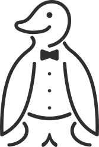

<h1 align="center">
  <br>
  
</h1>
<h4 align="center">Knut: your humble smart-home penguin</h4>

Knut 2 is a small, focused smart-home daemon: lights, rooms, groups, scenes and
scripted automations, exposed to Apple Home. There is no frontend; everything
is configured in a Ruby DSL. See [DESIGN.md](DESIGN.md) for the design.

- Zigbee lights and sensors through [zigbee2mqtt](https://www.zigbee2mqtt.io)
- Philips Hue through the bridge's local API (CLIP v2)
- One HomeKit bridge with groups as lightbulbs, scenes as momentary switches
  and an Auto switch
- Sun-driven auto mode, clock triggers and device-event automations

## Running with compose

The compose stack runs Mosquitto, zigbee2mqtt (for a TI CC2652 stick with
Z-Stack firmware) and Knut.

```sh
git submodule update --init       # mruby sources, needed for the build
cp .env.example .env              # set ZIGBEE_DEVICE and TZ
cp examples/config.rb config.rb   # then adapt
docker compose up -d --build
```

Knut uses the host network, because HomeKit finds the bridge over mDNS. It
reaches Mosquitto on `mqtt://127.0.0.1:1883`.

First steps:

1. **Pair Zigbee devices** in the zigbee2mqtt frontend on port 8080.
2. **Pair the Hue bridge and find devices:** run
   `docker compose run --rm knut discover`. For an unpaired Hue bridge, it asks
   you to press the link button. It then prints every device not yet in the
   config as a ready-to-paste DSL line.
3. **Check the config** with `docker compose run --rm knut check`, then
   `docker compose restart knut`.
4. **Add the bridge to Apple Home.** The setup code is in the log:
   `docker compose logs knut | grep "setup code"`. If an aborted pairing
   left the bridge hidden from the Home app, reset it with
   `docker compose stop knut && docker compose run --rm knut unpair && docker compose start knut`.

## Configuration

```ruby
location lat: 52.99, lon: 10.58
homekit  name: "Knut", port: 32000          # optional: pin:, host:

hue    "bridge", host: "192.168.1.20"
zigbee "z2m",    mqtt: "mqtt://127.0.0.1:1883"

room "Kitchen" do
  light "spot1",   zigbee: "0x00158d0001a2b3c4"
  light "spot2",   zigbee: "0x00158d0001a2b3c5"
  light "ceiling", hue: "1a2b3c4d-…", expose: true

  group "Spots", lights: [:spot1, :spot2] do
    map :spot2, brightness: ->(x) { x * 0.8 }
  end
end

room "Hallway" do
  light  "Light",  zigbee: "0x…"
  sensor "Motion", zigbee: "0x…"
end

scene "Movie Night", auto: false do
  set "Kitchen/Spots", brightness: 20, kelvin: 2200
end

on "Clock", at: "06:30" do                    # at: also takes a list
  activate "Movie Night"
end

on "Sun", :sunset, offset: -30 do |sun, now|   # also :sunrise
  turn_on "Kitchen/ceiling"
end

on "Hallway/Motion", :motion do |event, now|   # also :clear, :action, :change
  set "Hallway/Light", brightness: now.hour < 6 ? 5 : 60 unless on?("Hallway/Light")
end

on "Sun", :sun do |sun, now|                   # every minute
  adapt all_groups, kelvin: sun.elevation > 10 ? 4000 : 2400, transition: 60
end
```

- **Lights** take exactly one of `zigbee:` (IEEE address) or `hue:` (light
  resource id), plus `adapter: "name"` when several adapters of that kind
  exist. Lights in a group are hidden from HomeKit unless `expose: true`.
  Lights in no group are exposed.
- **Brightness mappings** get the group brightness 1–100 and return the
  light's. The result is clamped to 1–100.
- **Actions** in scenes and triggers: `set`, `turn_on`, `turn_off`, `adapt`,
  `activate`, `log`. **Queries:** `all_groups`, `all_lights`, `on?(path)`, and
  `state(path)` with `.on?`, `.brightness`, `.kelvin`, `.auto?`.
- `set` with `brightness:` or `kelvin:` also switches on, unless `on: false`.
- **The sun object** has `sun.elevation`, `sun.azimuth`, `sun.sunrise`,
  `sun.sunset` (`Time`, or `nil` during polar day or night) and `sun.up?`.
- **Device events:** `event.action`, `event[:occupancy]` and every other key
  of the device's payload.

### Auto mode

DESIGN.md has the full rules. The parts that are not spelled out there:

- `adapt` only moves entities that are in auto. For an entity that is off, it
  remembers the values, and the entity comes on with them.
- Actions from triggers never change auto mode. Only HomeKit, scenes and the
  Auto switch do.
- `turn_on` in an `auto: false` scene acts like switching on in HomeKit: if
  the entity was off, it goes back into auto.

## CLI

```
knut check [config.rb]         parse and validate, print the model
knut discover                  list unreferenced devices as DSL snippets
knut set <Room/Entity> <value> e.g. `knut set Kitchen/Spots 40% 2700K transition=2`
knut run                       the daemon
knut unpair                    forget all HomeKit pairings (daemon stopped)
```

`--config` (`KNUT_CONFIG`, default `/etc/knut/config.rb`) and `--state-dir`
(`KNUT_STATE_DIR`, default `/var/lib/knut`) apply to every command. The state
directory holds HomeKit pairings, Hue keys and auto/override state.

## Building

Building needs Rust, a C compiler, Ruby and rake (for mruby):

```sh
git submodule update --init
cargo build --release
cargo test
```

`MRUBY_SRC` points the build at other mruby sources. Two dependencies are
vendored:

- **mruby** is a submodule (3.4.0). Knut uses a thin C shim instead of the
  `minutus` crate, whose 0.5.0 release no longer compiles.
- **hap** (HomeKit) lives in `vendor/hap`, patched as described in
  `vendor/hap/PATCHES.md`.

## License

GPL-3.0-or-later. Mascot: Knut the penguin.
